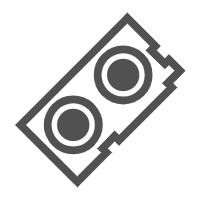
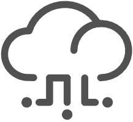
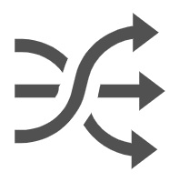
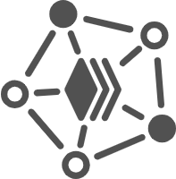
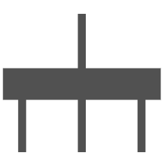
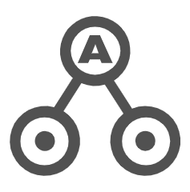
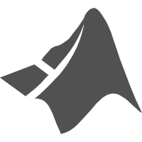
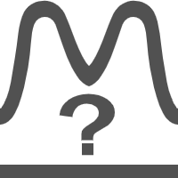
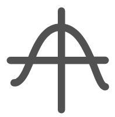

  <a href="/index.html">About</a>&nbsp;|&nbsp;
  <a href="/publications.html">Publications</a>&nbsp;|&nbsp;
  <a href="/blogs.html">Blogs</a>&nbsp;|&nbsp;
  <b>Notes</b>

# Notes

Here lies all of my lecture notes. I used to take structured notes on things I studied about. Alas, the good and peaceful school days have now passed.

### Computer Science

-  [Protocols & Systems Verification (*Wisc-CS839*)](/assets/file/notes/sys-verification.pdf)
-  [Topics in Persistent Memory (*Wisc-CS839*)](/assets/file/notes/pmem-topics.pdf)
-  [Topics in Machine Learning Systems (*WISC-CS839*)](/assets/file/notes/mlsys-topics.pdf)
-  [Advanced Database Systems (*WISC-CS764*)](/assets/file/notes/advanced-database-systems.pdf) ✭
-  [Big Data Systems (*WISC-CS744*)](/assets/file/notes/big-data-systems.pdf) ✭
-  [Advanced Distributed Systems (*WISC-CS739*)](/assets/file/notes/distributed-systems-wisc.pdf) ✭
-  [Advanced Operating Systems (*Wisc-CS736*)](/assets/file/notes/advanced-operating-systems.pdf) ✭
-  [Advanced Computer Networks (*WISC-CS740*)](/assets/file/notes/advanced-networks.pdf)
-  [Database Management Systems (*Wisc-CS564*)](/assets/file/notes/database-management.pdf) ✭
-  [Computer Graphics (*WISC-CS559*)](/assets/file/notes/computer-graphics.pdf)
-  [Operating Systems (*Wisc-OSTEP*)](/assets/file/notes/operating-systems-ostep.pdf) ✭ -- or in [html](/assets/file/ostep-note/operating-systems-ostep.html)
-  [Computer Architecture (*Wisc-CS552*)](/assets/file/notes/computer-architecture-wisc.pdf) ✭
-  [Distributed Systems Engineering (*MIT-6.824*)](/assets/file/notes/distributed-engineering.pdf)
-  [Computer Systems Security (*MIT-6.858*)](/assets/file/notes/security.pdf) ✭
-  [Computer Networks (*MIT-6.829*)](/assets/file/notes/computer-networks.pdf) ✭
-  [Automata, Computability, & Complexity (*MIT-6.045*)](/assets/file/notes/theory-computation.pdf) ✭
-  [Introduction to Machine Learning (*MIT-6.036*)](/assets/file/notes/machine-learning.pdf) ✭
-  [Artificial Intelligence (*MIT-6.034*)](/assets/file/notes/artificial-intelligence.pdf) ✭
-  [Distributed Systems (*ST-CS290K*)](/assets/file/notes/distributed-systems.pdf)
-  [Parallel Computing (*ST-CS121*)](/assets/file/notes/parallel-computing.pdf) ✭
-  [Computer Language & Compilers (*ST-CS131*)](/assets/file/notes/compilers.pdf) ✭
-  [Operating Systems (*ST-CS130*)](/assets/file/notes/operating-systems.pdf)
-  [Computer Architecture II (*ST-CS210*)](/assets/file/notes/computer-architecture-2.pdf)
-  [Computer Architecture (*ST-CS110*)](/assets/file/notes/computer-architecture.pdf)
-  [Data Structures (*ST-CS101*)](/assets/file/notes/data-structures.pdf) ✭

### Others

-  [Math Foundations for Machine Learning (*Wisc-ECE761*)](/assets/file/notes/math-foundations-for-ml.pdf)
-  [Introduction to Optimization (*Wisc-CS524*)](/assets/file/notes/optimization.pdf) ✭
-  [Probability & Statistics (*ST-SI140*)](/assets/file/notes/probability.pdf)
-  [Signals & Systems (*ST-EE150*)](/assets/file/notes/signals-systems.pdf) ✭
-  [Principles of Finance (*ST-FINA1003*)](/assets/file/notes/finance.pdf)
-  [Electric Circuits (*ST-EE111*)](/assets/file/notes/circuits.pdf)
-  [General Chemistry I (*ST-CHEM1102*)](/assets/file/notes/chemistry.pdf)

### Memorandum

- [Research (Conference) Paper Writing Streamline](/assets/file/notes/paper-writing.pdf)
- [Basic GDB Debugger Usage Cheatsheet](/assets/file/notes/gdb-usage.pdf) ✭
- [Operating Systems History Summary in an XMind Tree](https://www.xmind.net/m/2cpqNJ/)
- [Development Document/Tutorial of the Hux OS Kernel](https://github.com/josehu07/hux-kernel/wiki) ✭

### Reading Records

- [《Operating Systems: Three Easy Pieces》(OSTEP), 2018](/assets/file/notes/operating-systems-ostep.pdf) -- or in [html](/assets/file/ostep-note/operating-systems-ostep.html), Link to [Book](https://pages.cs.wisc.edu/~remzi/OSTEP/)
- [《大话存储》Final ver. (终极版), 2015](/assets/file/notes/book-dahuacunchu-zhangdong.pdf) -- Link to [Book](https://m.douban.com/book/subject/26325526/)
